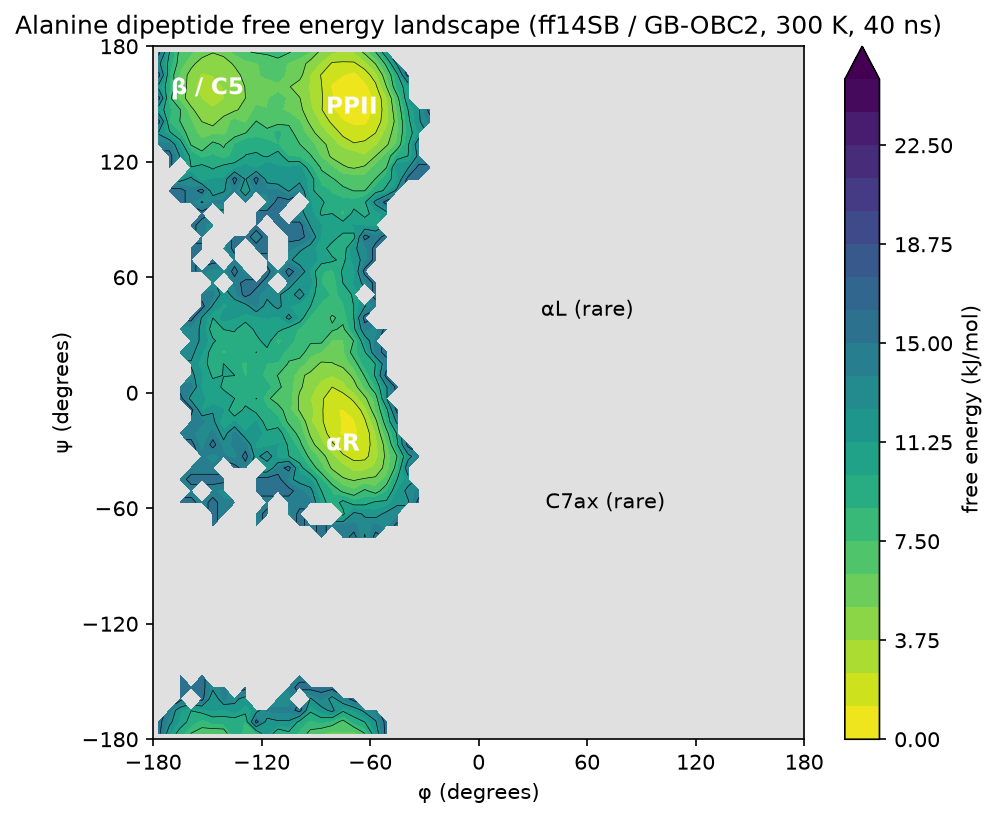
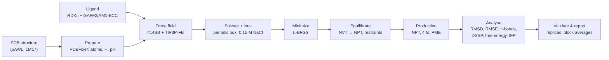

# Practical Molecular Dynamics Course

**A hands-on, 12-notebook course that teaches molecular dynamics (MD) step by step: from Newton's equations and a
10-line integrator you write yourself, to force fields, thermostats, PME, protein preparation, equilibration,
trajectory analysis, free energy landscapes, and a protein–drug simulation. Everything runs in your browser with
Google Colab.**

[](https://github.com/hentablihamza/practical-molecular-dynamics-course/actions/workflows/ci.yml)
[](https://www.python.org)
[](https://openmm.org)
[](https://colab.research.google.com/github/hentablihamza/practical-molecular-dynamics-course/blob/main/notebooks/01_what_is_md.ipynb)

MD is often taught as a black box: download a structure, run a few commands, get a movie. This course opens the
box. You first build a tiny MD engine in NumPy and recompute a real force field's energy by hand, then use
[OpenMM](https://openmm.org), [PDBFixer](https://github.com/openmm/pdbfixer), [MDTraj](https://www.mdtraj.org),
[MDAnalysis](https://www.mdanalysis.org), and [openmmforcefields](https://github.com/openmm/openmmforcefields) to run
and analyse the same kinds of simulations used in research and drug discovery. Every number in the notebooks
comes from code that was executed, and CI re-runs every notebook on each change.



*From Notebook 10: the free energy landscape of alanine dipeptide over its backbone angles φ and ψ, computed as
F = −kT ln P from 40 ns of simulation (4 independent replicas). Each contour is about 1 kT; grey regions were never visited, and the left-handed αL region was reached only a few times.*

## Who this is for

- **Chemistry, biology, pharmacy, and physics students and Ph.D. researchers** who need MD for their project and
  want to understand what the software is doing.
- **Medicinal and computational chemists** who want to check docking poses or protein–ligand interactions with MD.
- **Data scientists and ML researchers** entering molecular modelling who want a rigorous but practical start.

No MD background is needed. You need basic Python (NumPy, pandas, matplotlib) and high-school physics; every
concept is introduced as it appears. If you are new to Python for chemistry, start with the companion
[practical-cheminformatics-course](https://github.com/hentablihamza/practical-cheminformatics-course).

## MD workflow at a glance



## Syllabus

Click a badge to open that notebook in Colab, or browse the [`notebooks/`](notebooks) folder.

| # | Notebook | You will learn to… | Colab |
|---|----------|--------------------|-------|
| 01 | What is molecular dynamics? | write a velocity-Verlet MD engine in NumPy; Newton's equations, energy conservation, why femtosecond timesteps, barriers and rare events | [](https://colab.research.google.com/github/hentablihamza/practical-molecular-dynamics-course/blob/main/notebooks/01_what_is_md.ipynb) |
| 02 | Force fields explained | recompute every AMBER ff14SB energy term (bonds, angles, torsions, Lennard-Jones, Coulomb, 1-4 scaling) by hand and match OpenMM exactly | [](https://colab.research.google.com/github/hentablihamza/practical-molecular-dynamics-course/blob/main/notebooks/02_force_fields.ipynb) |
| 03 | Integrators, timestep & energy conservation | code a liquid-argon MD from scratch, test timesteps in NVE, then OpenMM; constraints and hydrogen mass repartitioning (2–4 fs) | [](https://colab.research.google.com/github/hentablihamza/practical-molecular-dynamics-course/blob/main/notebooks/03_integrators_timestep.ipynb) |
| 04 | Thermostats, barostats & ensembles | NVE/NVT/NPT; compare velocity rescaling, Andersen, Langevin, Nosé–Hoover; Maxwell–Boltzmann; water density with a Monte Carlo barostat | [](https://colab.research.google.com/github/hentablihamza/practical-molecular-dynamics-course/blob/main/notebooks/04_thermostats_barostats_ensembles.ipynb) |
| 05 | Periodic boundaries, cutoffs & PME | minimum image, neighbour lists, reaction field vs PME energy and force errors, Ewald splitting, box-size rules | [](https://colab.research.google.com/github/hentablihamza/practical-molecular-dynamics-course/blob/main/notebooks/05_periodic_boundaries_pme.ipynb) |
| 06 | Preparing a protein | PDBFixer on chignolin (5AWL) and EGFR (1M17): missing residues/atoms, heterogens, hydrogens, protonation vs pH | [](https://colab.research.google.com/github/hentablihamza/practical-molecular-dynamics-course/blob/main/notebooks/06_preparing_a_protein.ipynb) |
| 07 | Solvation, ions & minimization | water models, box shapes, 0.15 M NaCl, solute–image distance, L-BFGS minimization with a progress reporter | [](https://colab.research.google.com/github/hentablihamza/practical-molecular-dynamics-course/blob/main/notebooks/07_solvation_minimization.ipynb) |
| 08 | Equilibration & production | position restraints, NVT → NPT, release, DCD/log/checkpoint reporters, restart, ns/day | [](https://colab.research.google.com/github/hentablihamza/practical-molecular-dynamics-course/blob/main/notebooks/08_equilibration_production.ipynb) |
| 09 | Trajectory analysis | MDAnalysis + MDTraj on 3 replicas: RMSD, RMSF, radius of gyration, hydrogen-bond occupancy, DSSP | [](https://colab.research.google.com/github/hentablihamza/practical-molecular-dynamics-course/blob/main/notebooks/09_trajectory_analysis.ipynb) |
| 10 | Free energy landscapes | alanine dipeptide φ/ψ Ramachandran free energy surface, 1-D PMF, state populations and ΔF with replica error bars | [](https://colab.research.google.com/github/hentablihamza/practical-molecular-dynamics-course/blob/main/notebooks/10_free_energy_landscapes.ipynb) |
| 11 | Protein–ligand MD | EGFR kinase + erlotinib: RDKit ligand prep, GAFF2/AM1-BCC parameters, solvated complex, ligand RMSD, Met769 hinge H-bond, contacts, interaction fingerprint | [](https://colab.research.google.com/github/hentablihamza/practical-molecular-dynamics-course/blob/main/notebooks/11_protein_ligand_md.ipynb) |
| 12 | Good practices & mini project | equilibration, autocorrelation, block averaging, replicas, pitfalls, methods checklist, OpenMM script + Slurm job, GROMACS/AMBER equivalents | [](https://colab.research.google.com/github/hentablihamza/practical-molecular-dynamics-course/blob/main/notebooks/12_good_practices_mini_project.ipynb) |

Each notebook has **learning objectives**, explanations in Markdown, runnable code, and **exercises with
collapsible solutions**. Notebooks 01–05 teach the physics with small systems; 06–09 walk through a complete
protein simulation; 10–12 cover free energies, drug discovery, and good practice.

### What runs live and what is precomputed

Every notebook runs real simulations, but each live run is kept to seconds or a few minutes on a CPU (free
Colab included). Analyses that need longer sampling read small precomputed trajectories from [`data/`](data),
produced with the same protocol by [`scripts/generate_trajectories.py`](scripts/generate_trajectories.py):

| Notebook | Live in the notebook | Precomputed (in `data/trajectories/`) |
|---|---|---|
| 01–05 | everything (NumPy MD, OpenMM argon, alanine dipeptide, water boxes) | none |
| 06–07 | protein preparation, solvation, minimization | none |
| 08 | full equilibration + 40 ps production of solvated chignolin | 3 × 0.2 ns chignolin replicas (for comparison) |
| 09 | analysis of your own Notebook 08 run (`USE_OWN_TRAJECTORY = True`) | 3 × 0.2 ns chignolin replicas |
| 10 | 200 ps alanine dipeptide run | 4 × 10 ns φ/ψ time series |
| 11 | ligand prep, GAFF2/AM1-BCC parameters (conda) or precomputed file (Colab), complex build, minimization, 2 ps MD | 50 ps EGFR–erlotinib trajectory |
| 12 | analysis, a stand-alone OpenMM script and its smoke test | 3 × 0.2 ns chignolin replicas |

The precomputed trajectories are deliberately short teaching data (they rebuild in well under an hour on a laptop
CPU), long enough to demonstrate each method but far too short to support research conclusions. Notebook 12 shows how to tell the difference.

## How to use it

### Option 1: Google Colab (recommended, nothing to install)

Click any **Open in Colab** badge. The first cell installs OpenMM, PDBFixer, MDTraj, MDAnalysis, RDKit, and
py3Dmol with `pip` (about a minute) and downloads the course data. All 12 notebooks run this way, and the CI
pipeline tests exactly this pip setup.

The only step that needs conda packages is the **live ligand parameterization** in Notebook 11 (AmberTools is not
on PyPI); on Colab that notebook automatically uses the precomputed erlotinib parameters in
[`data/ligands/`](data/ligands). To run that step live on Colab as well,
install conda with [condacolab](https://github.com/conda-incubator/condacolab) in a first cell
(`!pip install -q 'condacolab==0.1.*'`, then `import condacolab; condacolab.install()`; the runtime restarts) and
then `!mamba install -q -c conda-forge openmm openmmforcefields openff-toolkit ambertools pdbfixer mdtraj rdkit`.
This optional route is not covered by CI.

### Option 2: Run locally (conda, full stack)

```bash
git clone https://github.com/hentablihamza/practical-molecular-dynamics-course.git
cd practical-molecular-dynamics-course

conda env create -f environment.yml      # or: mamba / micromamba
conda activate practical-molecular-dynamics-course

jupyter notebook                         # open the notebooks/ folder
```

Or with pip only: `pip install -r requirements.txt` (same scope as Colab). A GPU is optional; OpenMM uses it
automatically if you change `"CPU"` to `"CUDA"` or `"OpenCL"` in the notebooks.

### Offline use

Notebook 06 downloads PDB files from the RCSB when it can and falls back to the cached copies in
[`data/structures/`](data/structures). Set the environment variable `COURSE_OFFLINE=1` to force the cached path
everywhere (CI does this).

## Datasets

All files are small and documented in [`data/README.md`](data/README.md), with settings and dates in
[`data/provenance.json`](data/provenance.json):

- **PDB 5AWL**: chignolin CLN025, a 10-residue β-hairpin (X-ray, 1.11 Å); **PDB 1UAO**: original chignolin (NMR).
- **PDB 1M17**: EGFR kinase domain with the lung-cancer drug erlotinib (X-ray, 2.6 Å).
- **Alanine dipeptide** built with AmberTools tleap.
- **Erlotinib GAFF2/AM1-BCC parameters** for OpenMM.
- **Precomputed trajectories**: 4 × 10 ns alanine dipeptide (φ/ψ), 3 × 0.2 ns chignolin in water, 50 ps EGFR–erlotinib in water.

Regenerate everything with [`scripts/fetch_structures.py`](scripts/fetch_structures.py) and
[`scripts/generate_trajectories.py`](scripts/generate_trajectories.py).

## Related open-source projects

This course is part of a small set of open tools and courses for computational drug discovery:

- **[practical-cheminformatics-course](https://github.com/hentablihamza/practical-cheminformatics-course)**: 12 Colab notebooks from RDKit basics to QSAR and virtual screening.
- **[practical-biopython-course](https://github.com/hentablihamza/practical-biopython-course)**: 12 Colab notebooks from sequences to the EGFR–erlotinib structure used in Notebook 11 here.
- **[chembl-easy](https://github.com/hentablihamza/chembl-easy)**: one-command clean, ML-ready bioactivity downloads from ChEMBL (e.g. EGFR inhibitors).
- **[chem-curate](https://github.com/hentablihamza/chem-curate)**: reproducible bioactivity and structure curation for QSAR.
- **[qsar-split-bench](https://github.com/hentablihamza/qsar-split-bench)**: benchmark random, scaffold, cluster, and time splits to detect data leakage.

## Author

**Hamza Hentabli, Ph.D.**: AI/ML drug discovery and computational chemistry scientist, and former teacher who
has mentored Ph.D. and master's students. This course distills that teaching into material anyone can run.

- GitHub: [@hentablihamza](https://github.com/hentablihamza)
- Google Scholar: [publications](https://scholar.google.com/citations?user=-7dUlnMAAAAJ)
- ORCID: [0000-0002-9530-2815](https://orcid.org/0000-0002-9530-2815)

If these materials help your work or teaching, please cite them (see [`CITATION.cff`](CITATION.cff)). Issues and
suggestions are welcome.
